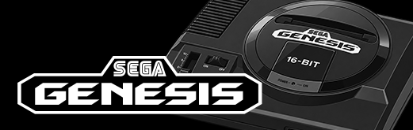

# SEGA Genesis for the Analogue Pocket

**A SEGA Genesis core with save states.** The MiSTer Genesis core, re-implemented on the Analogue Pocket with the following features:

- **Memories and Sleep.** Now you no longer need to complete games in a single sitting!
- **PAL support** with the option to run European games at 50 or 60 Hz
- **SVP chip** for playing Virtua Racing
- **EEPROM save support** for games such as Mega Man: The Wily Wars and Wonder Boy in Monster World
- **Up to four players** on the Analogue Dock, through 4-Way Play, Team Player or J-Cart.
- **The Analogizer**, for a CRT or TV and SNAC controllers.

## Installation

You need an Analogue Pocket on firmware 1.1 or later. No game data comes with
this core: you'll need your own Genesis / Mega Drive ROMs.

1. Download the zip from the latest release on GitHub and copy its `Cores`, `Platforms` and `Assets` folders onto your Pocket's SD card.
2. Copy your games into `Assets/genesis/common/`. The core takes `.md`, `.bin` and `.gen` files.
3. On the Pocket: openFPGA → Genesis, then pick a game.

## Saves

Games saves are stored `Saves/genesis/common/<game>.sav`

- Saves are written as 128 KB files. This is the same layout as the Spiritualized Genesis core, so game saves are compatible between the two cores
- 64 KB saves are read too. Note that these are then written back in the 128 KB format.
- Cartridges with a serial EEPROM save chip store data in the same `.sav`, in the same layout.

Your saves are worth backing up before you use them with a new
core: copy `Saves/genesis/common` off the card first.

## Memories and Sleep

The console is stopped between frames, so a Memory can be made at any point in
play.

A Memory keeps the speed it was made at. So one made at 50 Hz plays on at 50
Hz when loaded, regardless of Region and PAL 60 Hz, until Reset Core or a new game, which go back to the settings.

[`SAVE-STATES.md`](SAVE-STATES.md) has more on how Memories and Sleep work.

## Region and PAL

**Region** decides which console a game finds itself on. It and PAL 60 Hz are read as a game starts, so a change takes effect the next time a game is loaded:

- **Auto** reads the region from the cartridge: United States if it names it, then Europe, then Japan. A game made for Europe alone runs as on a European console at 50 Hz; one that also names another region runs at 60 Hz.
- **United States**, **Europe** or **Japan** for any game, for its language, its title or a lockout screen. Europe runs at 50 Hz.

**PAL 60 Hz** – when turned on, a game that would run at 50 Hz runs at 60
instead. Most PAL games were made for 50 Hz, so at 60 they run about a
fifth faster. PAL games that were not made for 50 Hz run slower than
intended and this is what the setting corrects for. Note that 240p games
cannot run at 60 Hz and in this situation the core will start the game
again at 50 Hz.

## Controls

| Pocket | Genesis |
| --- | --- |
| D-pad | D-pad |
| Y | A |
| A | B |
| B | C |
| L | X |
| X | Y |
| R | Z |
| Start | Start |
| Select | Mode |

## Core Settings

| setting | what it does |
| --- | --- |
| **Reset Core** | restarts the game, the same as the console's reset button |
| **Region** | Auto, United States, Europe or Japan (Region and PAL, above) |
| **PAL 60 Hz** | a game that would run at 50 Hz runs at 60 (above) |
| **Multitap** | None; 4-Way Play (EA's adapter); Team Player in port 1 or 2 (Sega's); J-Cart (Codemasters' cartridges with two pad ports of their own). With one on, the Dock's controllers 1 to 4 are the four players |
| **Lightgun** | a Menacer or Justifier in place of the second pad. The first player aims it with the d-pad, or with a Dock controller's left stick, A is the trigger, B its second button and Start its Start; a crosshair shows where it points. Lethal Enforcers I and II, Body Count, T2: The Arcade Game and Menacer 6-Game Cartridge get their own gun and timing |
| **Controller** | 6 Buttons, or 3 Buttons for the few older games that misread a 6-button pad |
| **Composite Blend** | None; Full, each pixel blended with the one beside it as a composite TV does, so the dithered see-through effects games drew for it (waterfalls, shadows) look as they were meant to; Adaptive, the same only where a pattern like that is found |
| **High Sprite Limit** | draws more sprites on a line than the console can, for less flicker. A game that hides things with the limit on purpose may show them. Off by default |
| **HiFi PCM** | smooths sampled sound and speech between the game's writes. Off by default, as a console plays it |
| **Audio Filter** | Model 1, the first Mega Drive's low-pass filter; Model 2, the later consoles'; Minimal, a light one; None |
| **FM Chip** | YM2612, the first consoles' sound chip with its distortion on quiet notes; YM3438, the later consoles' cleaner one |

## Analogizer

The core supports RndMnkIII's [Analogizer](https://github.com/RndMnkIII/Analogizer),
which plugs into the Pocket's cartridge slot. It sends the console's own
picture to a CRT or TV, and lets you play with SNAC controllers.

- **Video**: the console's 15 kHz picture as RGBS, RGsB, YPbPr or Y/C (NTSC or PAL), or 31 kHz for a VGA monitor through the scandoubler, with 0–75 % scanlines (HQ2x shows as the plain scandoubler). Y/C's colour stays right on a game running at 50 Hz.
- **Controllers**: DB15, NES, SNES and PC Engine pads through a SNAC adapter, for any of the four players. They work as the Pocket's own controls do, the Lightgun's aim and Multitap included.
- **Setup**: the core reads the shared `analogizer.bin` in `Assets/analogizer/common/`, which Pupdate or AnalogizerConfigurator writes. That file sets the video mode, the controllers and whether the Pocket's own screen stays on. Without it the core works as normal.

Once an Analogizer is set up in `analogizer.bin`, the core drives the cartridge
slot, as every Analogizer core does, so play with the adapter in the slot rather
than a game cartridge. Without it set up, the slot's pins are left idle, and a
cartridge left in the slot is fine.

## Known limits

- Genesis / Mega Drive cartridges only: no Sega CD, 32X or Master System games.
- `.smd` files are not taken; convert them to `.bin` first.

## Technical details

- The console is MiSTer's Genesis core, its `rtl/` as MiSTer had it in August 2022, with as few changes as the features above needed: [`THIRD-PARTY.md`](THIRD-PARTY.md) lists each one. The Pocket side, in `src/fpga/core/`, was written for this core: the bridge, the loaders, Core Settings, the save layout, the save states' bridge, PAL's clock and the picture.
- The ROM sits in the Pocket's SDRAM behind MiSTer's memory controller, refresh and all, and the 68000 waits for its refresh as on a real console.
- PAL games run on PAL's own 53.203424 MHz clock: the PLL is retuned while the console is held in reset, as MiSTer does it.
- The whole console runs in Verilator, a ROM in and frames and sound out, and is held against MAME and BlastEm: [`sim/genesis/README.md`](sim/genesis/README.md).

## Building it

The bitstream is built with Intel Quartus Prime Lite 21.1, run in Docker (the
`raetro/quartus:21.1` image, linux/amd64) under Colima, with the repository
somewhere under your home folder, which is all Colima shares:

```sh
brew install colima docker
sh tools/build.sh            # about 15 minutes; the fit and each clock's slack at the end
sh tools/build.sh --clean    # a full flow, nothing reused
```

The bitstream goes to `dist/Cores/frazilpop.Genesis/bitstream.rbf_r` only if
every clock meets timing; `dist/` is then the SD card's layout (add your games
to `Assets/genesis/common`).

The simulations need Verilator 5 and Python 3 (`brew install verilator`), and
fetch GHDL themselves into `build/tools` (its macOS release is for Apple
silicon). Each runs on its own:

| command | what it shows |
| --- | --- |
| `bash tools/sim.sh [rom]` | the whole console: frames (PNG) and sound (WAV) in `build/sim_genesis`; with no ROM, a test ROM of its own |
| `bash tools/top-test.sh` | `core_top.sv` against a stand-in Pocket: every setting, pad, a game in, a save and a Memory each way, the region and the clock |
| `bash tools/state-test.sh [rom] --pocket` | a Memory made and loaded, the loaded run the same as the run that made it, frame for frame |
| `bash tools/save-test.sh FOLDER` | `.sav` files through the core's save path and back |
| `bash tools/eeprom-test.sh` | the serial save chips, every mapper and chip |
| `bash tools/quirk-test.sh` | the per-game settings through a whole load |
| `bash tools/pal-test.sh` | the clock's change for PAL |
| `bash tools/video-test.sh` | the picture against the Pocket's video clock |
| `bash tools/jt12-scan-test.sh` | the YM2612 saved and restored for Memories |

[`sim/genesis/README.md`](sim/genesis/README.md) has the rest, MAME and
BlastEm beside the simulation among them.

## Credits and licence

- **MiSTer's Genesis core**: Alexey Melnikov (Sorgelig) and its contributors, Kitrinx, Sergey Dvodnenko (srg320), Gregory Hogan, Shane Lynch, GreyRogue, Till Harbaum and György Szombathelyi among them.
- **Gregory Estrade**: fpgagen, the first Genesis in an FPGA, whose VDP this still is.
- **Jorge Cwik (ijor)**: FX68K, the 68000.
- **Daniel Wallner**: T80, the Z80.
- **Jose Tejada (jotego)**: jt12, the YM2612, and jt89, the PSG.
- **Eric Lewis (ericlewis)**: openFPGA-Genesis, the first Genesis core for the Pocket, which this core follows, with **Marcus Andrade**'s and **Thomas Watson**'s fixes to it.
- **Shane Lynch**: the light guns, and Reset Core on the Pocket.
- **RndMnkIII** and **Franco Arza (arzacore)**: the Genesis forks this core follows, for how the game is loaded and held in memory and for Multitap with J-Cart.
- **RndMnkIII**: the Analogizer and its module, with **Mike Simone**'s Y/C encoder and **Till Harbaum**'s scandoubler from MiST.
- **agg23**: the Pocket utilities used for loading and sound.
- **Analogue**: the openFPGA core framework.
- Pocket core by **Frazilpop**.

[`THIRD-PARTY.md`](THIRD-PARTY.md) has the full credits and lists every part with its licence. The
core is GPL-3.0 as a whole, version 3 only ([`LICENSE`](LICENSE)), as
THIRD-PARTY.md explains.

Sega, Genesis and Mega Drive are trademarks of Sega. This project contains no
game data.
